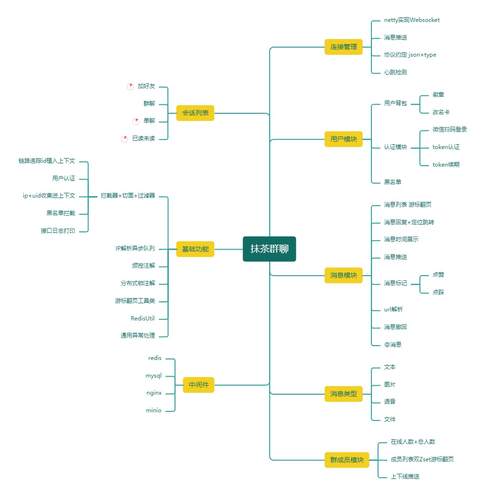
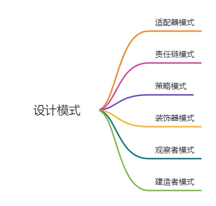
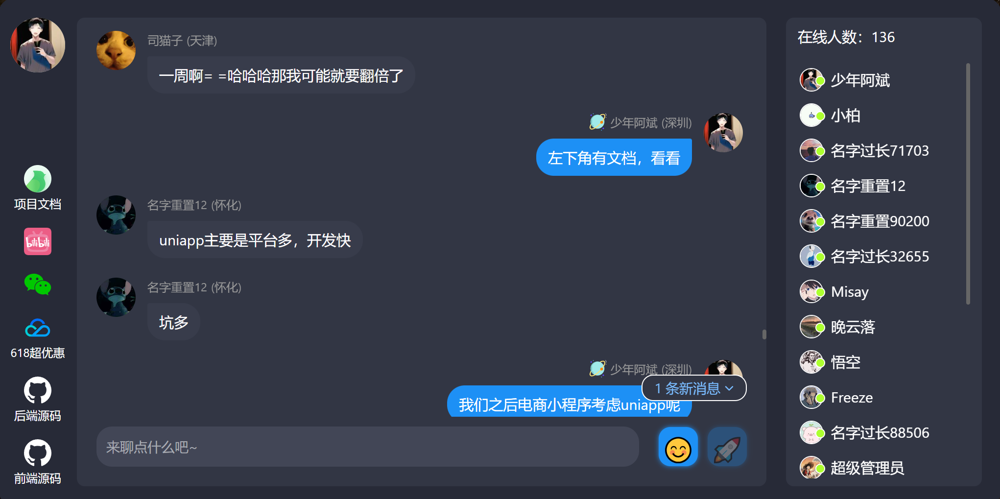
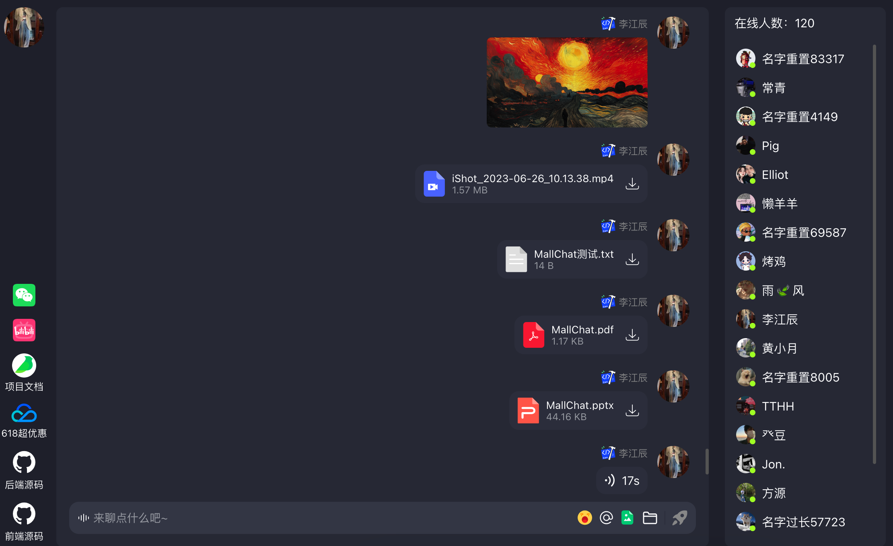
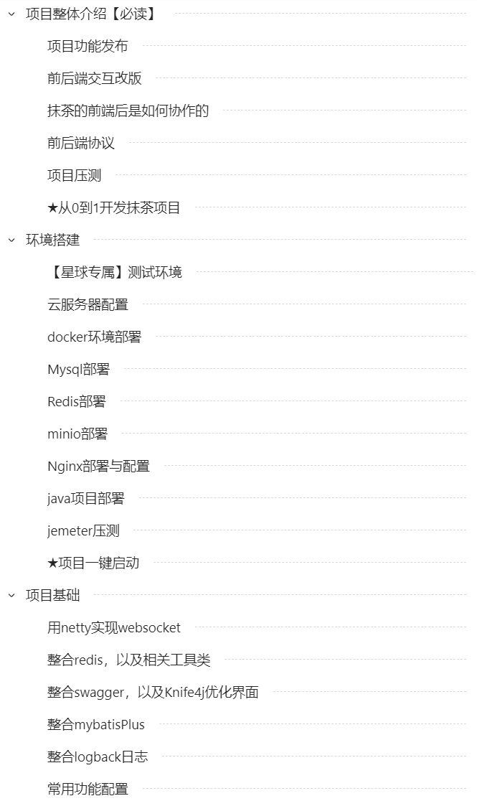
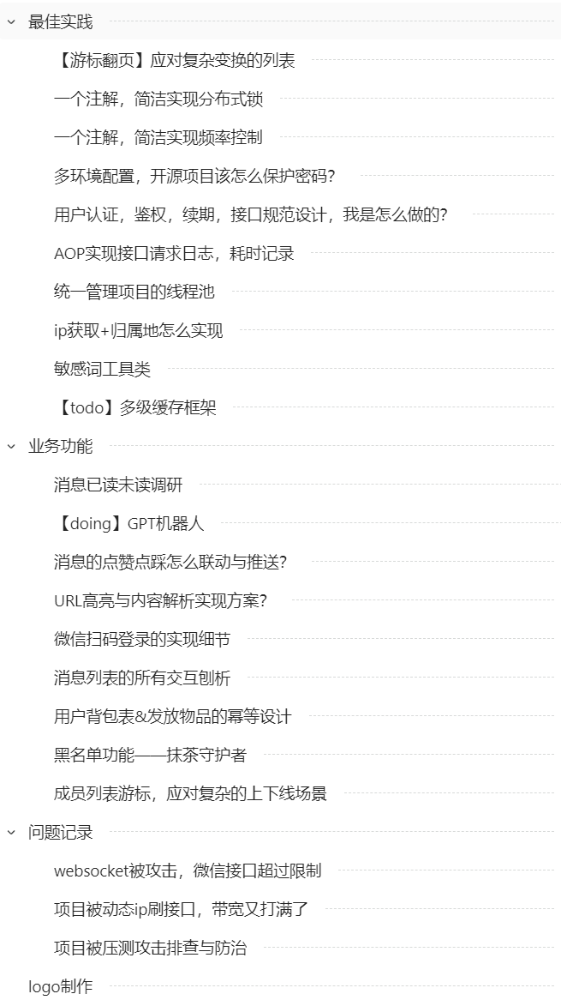

<p align="center">
    <a href="" target="_blank">
      
    </a>
</p>

<h1 align="center">MallChat-抹茶</h1>
<p align="center"><strong>一个即时聊天为主、附带商城场景的系统。致力于打造互联网企业级项目的最佳实践。<br>当前已实现：即时通讯（单聊/群聊/消息推送）、AI 智能回复、商户缓存、优惠券、秒杀下单。<br>购物车、支付、推荐、搜索、物流、客服为项目愿景，尚未实现——以"架构实现说明"一节的边界声明为准。<em>持续更新 ing～</em></strong></p>

<div align="center">
 <a href="#公众号"></a>
    <a href="#公众号"></a>
    <a href="https://github.com/zongzibinbin/MallChat"></a>
    <a href="https://gitee.com/zhongzhibinbin/MallChat"></a>
    <a href="https://github.com/Evansy/MallChatWeb"></a>
    <a href="https://github.com/zongzibinbin/MallChat/commits" target="_blank"><br>
    <a href="https://github.com/Evansy/MallChatWeb/actions/workflows/deploy.yml" target="_blank">
        
    </a>
    <a href="https://github.com/zongzibinbin/MallChat/commits" target="_blank">
        </a>
    <a href="https://github.com/zongzibinbin/MallChat/issues" target="_blank">
        
    </a> 
    <a href="https://github.com/zongzibinbin/MallChat/blob/master/LICENSE" target="_blank">
        
    </a> 
    <a href="https://github.com/zongzibinbin/MallChat/stargazers" target="_blank">
        
    </a> 
    
</div>

## 项目导航

- **快速体验地址**：[抹茶聊天首页](https://mallchat.cn)
- **前端项目仓库**：[MallChatWeb](https://github.com/Evansy/MallChatWeb)
- **项目视频记录**：[Bilibili地址](https://space.bilibili.com/146719540) 全程分享项目进度，功能选型的思考，同时征集迭代建议。
- **项目学习文档**：10w+字，保姆级教学路线，环境搭建、核心功能、基建轮子、接口压测、问题记录、一个不落。可点击[抹茶项目文档](https://www.yuque.com/snab/planet/cef1mcko4fve0ur3)查看（内含500人交流大群）
- **项目交流群**：对抹茶感兴趣的，可以加入[交流群](#公众号)。你的每一个举动，都会决定项目未来的方向。无论是提意见做产品经理，还是找bug做个测试人员，又或者加入开发小模块成为contributer，都欢迎你的加入。
- **码云仓库**：[Gitee](https://gitee.com/zhongzhibinbin/MallChat)（国内访问速度更快）

## 项目介绍

抹茶聊天是一个IM项目，通过netty实现和前端的websocket连接。内含微信扫描登录，成员列表，消息列表，消息互动，丰富的消息类型，还有很多实用的小轮子列如aop日志，分布式锁注解，频控注解，ip解析归属地等，持续更新中。。。





### 项目演示

#### C端项目

- 前端源码地址：[https://github.com/Evansy/MallChatWeb](https://github.com/Evansy/MallChatWeb)
- 项目演示地址：[https://mallchat.cn](https://mallchat.cn) (记住抹茶.cn，下次工作摸鱼可直接打开)





### 技术选型

#### 后端技术

|        技术         | 说明                                       | 官网                                                         |
| :-----------------: | ------------------------------------------ | ------------------------------------------------------------ |
|     SpringBoot      | web开发必备框架                            | [https://spring.io/projects/spring-boot](https://spring.io/projects/spring-boot) |
|       MyBatis       | ORM框架                                    | http://www.mybatis.org/mybatis-3/zh/index.html               |
|     MyBatisPlus     | 零sql，简化数据库操作，分页插件            | [https://baomidou.com/](https://baomidou.com/)               |
|        Redis        | 缓存加速，多数据结构支持业务功能           | [https://redis.io](https://redis.io)                         |
|      Caffeine       | 本地缓存                                   | http://caffe.berkeleyvision.org/                             |
|        Nginx        | 负载均衡，https配置，websocket升级，ip频控 | [https://nginx.org](https://nginx.org)                       |
|       Docker        | 应用容器引擎                               | [https://www.docker.com](https://www.docker.com)             |
|         Oss         | 对象存储                                   | [https://letsencrypt.org/](https://letsencrypt.org/)         |
|         Jwt         | 用户登录，认证方案                         | [https://jwt.io](https://jwt.io)                             |
|       Lombok        | 简化代码                                   | [https://projectlombok.org](https://projectlombok.org)       |
|       Hutool        | Java工具类库                               | https://github.com/looly/hutool                              |
|     Swagger-UI      | API文档生成工具                            | https://github.com/swagger-api/swagger-ui                    |
| Hibernate-validator | 接口校验框架                               | [hibernate.org/validator/](hibernate.org/validator/)         |
|        minio        | 自建对象存储                               | https://github.com/minio/minio                               |

#### 前端技术

前往[MallChatWeb](https://github.com/Evansy/MallChatWeb)查看

### 架构实现说明

> 本节描述**当前代码实际实现**的架构，刻意区分"已实现"与"未实现/不适用"，便于代码审阅与简历核对。
> 涉及的关键类均标注了文件路径，可直接对照源码验证。

#### 一、WebSocket 连接层

Netty 独立服务，与业务 HTTP 端口（8080）分离，监听 `8090`（`websocket/NettyWebSocketServer.java`）。

**连接管理与精准推送**

采用「本地会话表 + MQ 广播」而非 Netty `ChannelGroup`，原因见下方说明：

| 结构 | 位置 | 作用 |
| --- | --- | --- |
| `ONLINE_WS_MAP` | `WebSocketServiceImpl:67` | `Channel → WSChannelExtraDTO`，记录每个连接绑定的 uid |
| `ONLINE_UID_MAP` | `WebSocketServiceImpl:71` | `uid → CopyOnWriteArrayList<Channel>`，支持同一用户多端在线 |
| `WAIT_LOGIN_MAP` | `WebSocketServiceImpl:60` | Caffeine 本地缓存 `loginCode → Channel`，扫码登录等待态，1 小时过期 |

推送能力（`WebSocketServiceImpl`）：
- `sendToUid(wsBaseResp, uid)`：按 uid 精准推送给该用户的所有在线端
- `sendToAllOnline(wsBaseResp, skipUid)`：全员广播，支持跳过指定用户
- 发送动作统一提交到 `ThreadPoolTaskExecutor`（`ThreadPoolConfig.WS_EXECUTOR`），避免阻塞 Netty EventLoop

**Pipeline 组装**（`NettyWebSocketServer:66-95`）：`IdleStateHandler(30s 读空闲)` → `HttpServerCodec` → `ChunkedWriteHandler` → `HttpObjectAggregator(8192)` → `HttpHeadersHandler`（提取客户端 IP 存入 Channel Attribute）→ `WebSocketServerProtocolHandler("/")` → `NettyWebSocketServerHandler`

**用户绑定与上下线**（`NettyWebSocketServerHandler` + `WebSocketServiceImpl`）：
握手完成（`HandshakeComplete`）后触发 `connect()` 并尝试用 URL 携带的 token 自动 `authorize()`；校验通过则写入 `NettyUtil.UID` Attribute 并触发 `UserOnlineEvent`。断连时 `channelInactive` / `handlerRemoved` 触发 `removed()`，该用户**全部端**下线后才触发 `UserOfflineEvent`。在线状态写入 Redis ZSet（`UserCache.online/offline`），`getOnlineNum()` 通过 `zCard` 统计。

**设计取舍：为什么没有用 ChannelGroup**

`ChannelGroup` 是单进程内的连接容器，在水平扩容后**只能遍历到当前实例的连接**，跨节点的用户仍需额外做实例路由。本项目改用「每个实例维护自己的本地会话表 + RocketMQ `BROADCASTING` 广播消息到所有实例 + 各实例只推自己本地连接」的模型，扩容时无需改造推送逻辑，工程上更直接。代价是每个实例都会收到全量广播消息，由实例自行过滤。

#### 二、分布式锁：用户登录态并发控制

**问题**：`LoginServiceImpl.login()` 原本是典型的 read-modify-write——先读 Redis 中是否已有 token，没有则签发新 token 再写回。并发调用下会各签各的、互相覆盖，而 `verify()` 又要求「客户端 token == Redis 中的最新 token」，于是先返回给客户端的那个 token 会立即失效。

**修复**（`LoginServiceImpl.login()`）：

```
快路径：Redis 中已有 token → 直接复用，不加锁
慢路径：Redisson 分布式锁（按 uid 粒度，key = mallchat:login:token:lock:{uid}，等待 3s）
          → 锁内双重检查
          → jwtUtils.createToken(uid)
          → RedisUtils.setIfAbsent(key, token, 5, DAYS)   ← SETNX 语义，只让第一个写入者生效
降级：获取锁超时（BusinessException）→ 说明已有线程正在签发，读取并复用其结果
```

- 锁用 `LockService` 显式调用，**没有**用 `@RedissonLock` 注解——注解走 AOP 代理，类内自调用不会经过代理，会静默失效
- `setIfAbsent` 为本次新增（`common/utils/RedisUtils.java`），序列化格式与原 `set` 保持一致，不影响 `getStr` 读取
- 锁粒度按 uid 隔离，不同用户登录互不阻塞

**其余 Redisson 使用点**（本项目锁的既有用途，均为写操作幂等/并发安全）：领奖幂等 `UserBackpackServiceImpl:47`、好友申请与审批 `FriendServiceImpl:104,166`、表情收藏 `UserEmojiServiceImpl:52`、消息点赞 `ChatServiceImpl:209`、房间操作 `RoomAppServiceImpl:231`。

#### 三、扫码登录：微信公众平台网页授权

**接入体系说明**：本项目对接的是**微信公众平台（公众号）**，使用 `me.chanjar.weixin.mp`（WxJava 公众号 SDK），配置项为 `wx.mp.configs[appId/secret/token/aesKey]`。
**不是**微信开放平台（网站应用扫码，`open.weixin.qq.com/connect/qrconnect` + `WxOpenService`）——两者是独立的接入体系，勿混用。

**完整链路**：

```
① WS 请求登录（WSReqTypeEnum.LOGIN）
   WebSocketServiceImpl.handleLoginReq()
   → generateLoginCode()：Redis 原子自增生成不重复登录码
   → 本地 Caffeine 存 loginCode → Channel
   → 微信 qrCodeCreateTmpTicket(code) 生成带参临时二维码，下发前端展示

② 用户扫码 → 微信回调公众号服务器
   WxPortalController → ScanHandler → WxMsgService.scan()
   → 已注册用户：直接发 LOGIN_MSG_TOPIC；未注册：先 register() 落库
   → Redis 存 openid → loginCode 映射（60 分钟）
   → 发 SCAN_MSG_TOPIC，前端收到"扫码成功，等待授权"

③ 授权回调
   WxPortalController.callBack → WxMsgService.authorize()
   → OAuth2 获取 WxOAuth2UserInfo，填充昵称头像
   → 发送 LOGIN_MSG_TOPIC（带上 uid 与 loginCode）

④ Token 签发与 WebSocket 绑定
   MsgLoginConsumer（BROADCASTING，所有实例都收到）
   → 持有该 loginCode 的实例命中本地 WAIT_LOGIN_MAP
   → 移除 code → loginService.login(uid) 签发 token（见第二节并发控制）
   → loginSuccess()：绑定 Channel 与 uid、写 NettyUtil.UID、回推登录成功、触发 UserOnlineEvent
```

关键点：`loginCode ↔ Channel` 是**实例本地**状态，所以第 ④ 步必须用 `BROADCASTING` 让所有实例都收到消息，由持有该连接的实例完成绑定。

#### 四、RocketMQ 异步消息管道

`MQProducer` 封装发送（`mallchat-transaction`），四个消费组：

| 消费者 | Topic / 消费组 | 广播模式 | 职责 |
| --- | --- | --- | --- |
| `MsgSendConsumer` | `chat_send_msg` / `chat_send_msg_group` | 集群 | 消息落库后的会话更新、群成员推送、AI 回复触发 |
| `PushConsumer` | `websocket_push` / `websocket_push_group` | BROADCASTING | 按 uid / 全员推送 WS 消息 |
| `MsgLoginConsumer` | `user_login_send_msg` / `user_login_send_msg_group` | BROADCASTING | 定位持有登录码的实例并完成登录绑定 |
| `ScanSuccessConsumer` | `user_scan_send_msg` / `user_scan_send_msg_group` | BROADCASTING | 通知前端"扫码成功，等待授权" |

（Topic 与消费组常量定义见 `common/constant/MQConstant.java`）

**发消息主链路的异步化**：`ChatServiceImpl` 落库后仅发布 `MessageSendEvent`（`ChatServiceImpl:109`），耗时逻辑由 `MessageSendListener` 在事务边界后处理——`messageRoute` 用 `@TransactionalEventListener(BEFORE_COMMIT)` 触发 `sendSecureMsg()` 投递 MQ。

`sendSecureMsg` 上的 `@SecureInvoke`（`mallchat-transaction`）提供的是**事务同步执行 + 失败重试**保证，而非本地消息表：它把调用信息落库 `SecureInvokeRecord`（记录类名、方法名、参数），注册 `TransactionSynchronization.afterCommit` 在**事务提交后**才真正执行，失败则按 `2^n` 分钟退避重试（上限由 `maxRetryTimes` 控制），并由 `@Scheduled` 每 5 秒扫描待重试记录。需注意：`invoke()` 在**非事务状态下直接 return 不做任何保证**，因此该机制只在事务上下文中生效。

**接口响应耗时优化**：写扩散、群成员推送、微信模板消息推送等重活全部搬到消费端，主链路只做落库与事件投递。

**水平扩容下的推送**：`PushService` → `PUSH_TOPIC`（BROADCASTING）→ 每个实例收到后只推自己 `ONLINE_UID_MAP` 中的连接，因此扩容无需改动推送逻辑。

#### 五、商城模块（商户 / 优惠券 / 秒杀）

> 本节对应 `com.abin.mallchat.common.mall` 包，参考黑马点评（hmdp）的经典商城场景移植到本项目，
> 复用本项目的 `RequestHolder` JWT 鉴权与 RocketMQ 基础设施。共 5 张表（`mallchat-mall.sql`）。

**5.1 商户缓存三方案（对比演示）**

同一份商户数据提供三条查询路径，用于对比缓存穿透与击穿的经典解法：

| 方案 | 入口 | 实现 |
| --- | --- | --- |
| 空值占位防穿透 | `GET /capi/mall/public/shop/{id}` | 查库为空时写入空串占位，短期 TTL，挡住反复打库的无效 id |
| 互斥锁防击穿 | `GET /capi/mall/public/shop/{id}/mutex` | `MallCacheClient` 用 Redisson 锁，只放一个线程重建缓存 |
| 逻辑过期防击穿 | `GET /capi/mall/public/shop/{id}/logical` | 缓存存 `RedisData{data, expireTime}`，逻辑过期后异步重建（需先 `GET /capi/mall/shop/preheat/{id}` 预热），允许短暂脏读换取高可用 |

缓存 key 规范见 `mall/constant/MallRedisKey.java`，统一前缀 `mallchat:mall:`。

**5.2 按距离查询商户（Redis GEO）**

`GET /capi/mall/public/shop/of/type?typeId=1&x=121.4737&y=31.2304`，传经纬度则按距离由近到远返回并回填 `Shop.distance`。

实现要点（`ShopServiceImpl.queryByType`）：
- GEO 集合按类型分桶：`mallchat:mall:shop:geo:{typeId}`，启动时由 `MallGeoInitializer` 导入（`GEOADD` 为覆盖语义，重复执行无副作用）
- **必须用 `geoRadius` 而非 `geoSearch`**：本项目 Redis 客户端是 Redisson 3.17.1，`redisson-spring-data-26` 只实现了 `geoRadius`；`DefaultedRedisConnection.geoSearch` 在缺少驱动实现时会**递归调用自身**，最终抛 `StackOverflowError`——这是 `Error` 不是 `Exception`，用 `catch (Exception)` 兜不住，会直接 500
- GEO 不可用（未初始化 / 该类型无坐标数据）时**降级为普通分页**，保证接口始终可用
- 距离顺序用 `ORDER BY FIELD(id, ...)` 还原：DB 的 `IN` 查询不保证顺序，仅靠回填 distance 会让顺序丢失

**5.3 秒杀全链路（Lua 原子 + MQ 异步落库）**

```
POST /capi/mall/seckill/{voucherId}
  → seckill.lua 单脚本原子完成三件事：判库存、判一人一单、扣库存并记用户
      返回 0 成功 / 1 无库存 / 2 重复下单
  → 投递 RocketMQ（topic=mall_seckill_order, group=mall_seckill_order_group）
  → 立即返回 orderId（不阻塞等待落库）

SeckillOrderConsumer（集群消费）
  → Redisson 锁 + UniqueKey 二次幂等
  → 乐观扣减：UPDATE ... SET stock = stock - 1 WHERE stock > 0
  → 写入 tb_voucher_order
```

- 库存与"一人一单"集合分别存 `mallchat:mall:seckill:stock:{id}`、`mallchat:mall:seckill:order:{id}`
- 下单接口先经 Lua 拦截，因此重复请求在**入队前**就被拒，不会给 MQ 造成无效流量
- 订单 id 由 `RedisIdWorker` 生成（时间戳左移 + Redis 自增序列，见 `mall/service/RedisIdWorker.java`）
- 表上有 `uniq_user_voucher(user_id, voucher_id)` 唯一索引，作为 DB 层最后一道兜底

**5.4 接口一览**

| 方法 | 路径 | 说明 |
| --- | --- | --- |
| GET | `/capi/mall/public/shop-type/list` | 全部商户类型 |
| GET | `/capi/mall/public/shop/{id}` | 商户详情（空值占位） |
| GET | `/capi/mall/public/shop/{id}/mutex` | 商户详情（互斥锁） |
| GET | `/capi/mall/public/shop/{id}/logical` | 商户详情（逻辑过期） |
| GET | `/capi/mall/public/shop/of/type` | 按类型分页 / 按距离排序 |
| PUT | `/capi/mall/shop` | 更新商户并删缓存（Cache Aside） |
| GET | `/capi/mall/shop/preheat/{id}` | 逻辑过期缓存预热 |
| GET | `/capi/mall/shop/geo/init` | 手动导入 GEO 数据 |
| GET | `/capi/mall/public/voucher/of/shop` | 商户优惠券 |
| GET | `/capi/mall/public/voucher/seckill/list` | 秒杀券列表（含库存回填） |
| POST | `/capi/mall/seckill/warmup/{id}` | 秒杀库存预热到 Redis |
| POST | `/capi/mall/seckill/{id}` | 秒杀下单 |
| GET | `/capi/mall/order/my` | 我的优惠券订单 |

路径含 `/public/` 的接口由 `TokenInterceptor.isPublicURI` 放行，其余需登录。

**5.5 端到端验证**

`_probe/mall-e2e.mjs`（18 项断言，`node mall-e2e.mjs http://127.0.0.1:8080`）：

```
✅ 商户类型列表（10 条）        ✅ 商户详情 / 缓存穿透 / 空值占位
✅ 逻辑过期方案（预热后）        ✅ 互斥锁方案
✅ 按类型分页查询               ✅ GEO 未初始化时降级可用
✅ GEO 数据导入（12 个商户）     ✅ GEO 按距离排序（最近优先）
✅ GEO 结果距离单调递增          ✅ 商户优惠券列表
✅ 秒杀券列表（含库存回填）      ✅ 秒杀库存预热
✅ 秒杀下单返回订单id           ✅ MQ 异步落库成功
✅ 一人一单拦截（重复下单）      ✅ 库存扣减正确（100 → 99）

===== 结果: 18 通过 / 0 失败 =====
```

#### 六、边界声明（未实现 / 不适用 / 待验证）

- **未使用 `ChannelGroup`**：全仓库无 `ChannelGroup` / `DefaultChannelGroup`，连接管理见第一节，请勿描述为 ChannelGroup。
- **未使用微信开放平台**：扫码登录基于公众号带参二维码，见第三节。
- **"万级并发连接"尚无压测数据支撑**：仓库内无 JMeter 等压测脚本与连接数报告，`src/test` 仅有功能联通性测试。如需写入简历，建议先完成一次真实压测并留存数据。
- **购物车 / 支付 / 物流 / 客服 未实现**：商城模块目前只覆盖「商户 + 优惠券 + 秒杀下单」三个场景（第五节），秒杀下单后**无支付环节**，订单直接落库为已支付状态。README 开头"电商该有的都必须有"为项目愿景，非现状。
- **`ONLINE_UID_MAP` 可能残留空列表**：`offline()` 中 `removeIf` 后未移除空集合条目。

> 已修复的历史遗留问题（保留记录，便于对照代码演进）：
> - **心跳处理原为空实现** → 现已实现：`WRITER_IDLE` 由服务端主动下发 `PingWebSocketFrame`，`channelRead` 消费 `PongWebSocketFrame`，`READER_IDLE` 触发下线（`NettyWebSocketServerHandler`）。
> - **WS 端口原为硬编码** → 现已可配置：`NettyWebSocketServer` 改用 `@Value("${netty.websocket.port:8090}")`。

### 环境搭建

在项目目录下的`application.yml`修改自己的启动环境`spring.profiles.active` = `test`然后找到同级文件`application-test.properties`，填写自己的环境配置。[星球成员](https://www.yuque.com/snab/planet/cne0nel2hny8eu4i)提供一套测试环境配置，可直连

### 项目文档

保姆级教学路线，涵盖环境搭建、核心功能实现、基础架构构建、接口压力测试、问题记录以及项目的亮点。无一遗漏持续不断地更新中～  
查看[项目文档](https://www.yuque.com/snab/planet/cef1mcko4fve0ur3)

<div style="display: flex; align-items: center;">
  
  
</div>

## star 趋势图


## 贡献
**贡献之前请先阅读[行为准则](CODE_OF_CONDUCT.md) 和 贡献指南。感谢所有为 MallChat 做过贡献的人!**

#### 后端:

<a href="https://github.com/zongzibinbin/MallChat/graphs/contributors">
  
</a>  

#### 前端:

<a href="https://github.com/Evansy/MallChatWeb/graphs/contributors">

</a>

<h4>优秀贡献者:</h4>

<table>
  <tr>
    <th>类别</th>
    <th>用户</th>
    <th>贡献模块</th>
  </tr>
  <tr>
    <td rowspan="3">前端</td>
    <td rowspan="3">
      <a href="https://github.com/LIjiAngChen8"></a>
    </td>
    <td><a href="https://github.com/Evansy/MallChatWeb/pull/74">图片、语音、文件类型消息收发</a></td>
  </tr>
  <tr>
    <td><a href="https://github.com/Evansy/MallChatWeb/pull/50">消息互动操作(撤回、点赞、删除)</a></td>
  </tr>
  <tr>
    <td><a href="https://github.com/Evansy/MallChatWeb/pull/17">虚拟列表</a></td>
  </tr>
  <tr>
    <td rowspan="5">后端</td>
    <td rowspan="2">
      <a href="https://github.com/1045078399"></a>
    </td>
    <td><a href="https://github.com/zongzibinbin/MallChat/pull/31">DFA敏感词检测</a></td>
  </tr>
  <tr>
    <td><a href="https://github.com/zongzibinbin/MallChat/pull/64">OpenAI聊天机器人</a></td>
  </tr>
  <tr>
    <td rowspan="1">
      <a href="https://github.com/xiaocairush"></a>
    </td>
    <td><a href="https://github.com/zongzibinbin/MallChat/pull/99">Ac自动机敏感词检测</a></td>
  </tr>
    <tr>
    <td rowspan="1">
      <a href="https://github.com/linzhihan"></a>
    </td>
    <td><a href="https://github.com/zongzibinbin/MallChat/pull/95">限流编程式</a></td>
  </tr>
    <tr>
    <td rowspan="1">
      <a href="https://github.com/zbzbzzz"></a>
    </td>
    <td><a href="https://github.com/zongzibinbin/MallChat/pull/82">握手认证</a></td>
  </tr>
</table>


## License
[Apache License 2.0](./LICENSE)
## 公众号

微信搜索 **阿斌Java之路** 关注我的原创公众号，后台回复「**抹茶**」即可加入抹茶交流群，一些做过公司万人群聊，高并发的小伙伴都在里面讨论方案。公众号也会经常更新项目相关的文档，等你来撩~~


